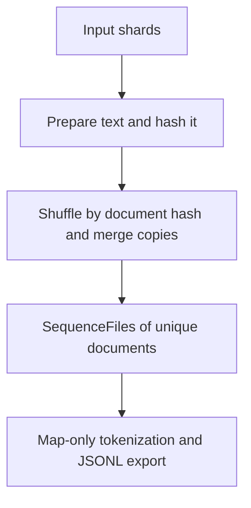

Distdemo used to give me two answers to the same question. I could run the ratings jobs in Java on Hadoop and in Scala on Spark, then compare their outputs. Their files could arrive in a different order while the records still agreed. The comparator ignored row order and preserved duplicate counts. That was a useful rule to carry into the next version. [The ratings lab at its last revision](https://github.com/jayhuangsci/distributedSysUtilsDemo/blob/f61e83fedbd7333487dcc6fd3de5b2e96b90795e/README.md)

The new version takes plain text or HTML and produces a corpus in JSONL. The Spark side went away. I could still change one thing about the execution and ask whether the answer changed. If Hadoop goes from one reducer to three, the output should move between tasks and files. I want the training rows to stay the same.

## Two jobs, one place to shuffle

In the first job, mappers extract, normalize, and redact text. Each accepted document goes out under the hash of the prepared text. That puts all equal keys at the same reducer, including copies that originated in different input files. Reducers write one SequenceFile record per distinct prepared document.

The second job starts from those records. A single mapper can assign a document to train or validation, slide a token window over it, and write its chunks. Each of those decisions needs information from that document alone. Setting the reducer count to zero for this job avoids shuffling chunks that already know where they belong. The cost is an intermediate write and a second job startup. That buys a place to finish document-level work before it fans out into chunks. [Both job definitions](https://github.com/jayhuangsci/distributedSysUtilsDemo/blob/67741320b1d918157aeb032e77d9de616f8606e4/src/main/java/io/github/jayhuangsci/corpus/hadoop/CorpusPipeline.java#L63-L104)



## Can the test break a line in half?

The fixture generates 24 documents in four files and intentionally repeats four of them. It also limits the uncompressed input split size to 64 bytes. That forces a distinction between a file split, which is a range of bytes, and a line, which is the record the mapper should get. Each reader owns complete lines whose starting offsets are in its range, even if it has to finish reading past the end of its split. A reader starting partway through the file seeks one byte back to skip what belongs to its predecessor. If that byte is a newline, the next full line starts right at the boundary and the reader keeps it. [The split reader](https://github.com/jayhuangsci/distributedSysUtilsDemo/blob/67741320b1d918157aeb032e77d9de616f8606e4/src/main/java/io/github/jayhuangsci/corpus/hadoop/DocumentInputFormat.java#L49-L76) · [The test configuration and fixture](https://github.com/jayhuangsci/distributedSysUtilsDemo/blob/67741320b1d918157aeb032e77d9de616f8606e4/src/test/java/io/github/jayhuangsci/corpus/hadoop/PipelineIntegrationTest.java#L32-L90)

I compared the archived outputs from the two runs. Both read 24 documents and produced 20 unique documents. Both exported 77 train chunks and 50 validation chunks. The two files of sorted JSONL records were byte-for-byte equal. The manifests were different. Reducer counts, job IDs, and shuffle bytes describe the execution, so they have room to change. The assertion compares the records, including their IDs and metadata. It gives the partitioning changes some freedom while holding the result to a precise contract. [Local Hadoop verification job](https://github.com/jayhuangsci/distributedSysUtilsDemo/actions/runs/44188064646/job/134409777838) · [Reading and comparing the records](https://github.com/jayhuangsci/distributedSysUtilsDemo/blob/67741320b1d918157aeb032e77d9de616f8606e4/src/test/java/io/github/jayhuangsci/corpus/hadoop/PipelineIntegrationTest.java#L43-L90)

The Linux integration test saves the sorted records under `target/pipeline-evidence`. This runs the single fixture and compares the two files.

```bash
./mvnw -B \
  '-Dtest=PipelineIntegrationTest#splitBoundariesDedupAndChunkIdentityAreIndependentOfReducerCount' \
  test
cmp target/pipeline-evidence/reducers-1-records.jsonl \
    target/pipeline-evidence/reducers-3-records.jsonl
```

That comparison is now the first thing I look for when changing the batch architecture. The original ratings lab asked whether two implementations agreed. The corpus fixture asks whether the same implementation can change how it divides the work without changing the meaning of its output.

[More Distdemo articles](/tags/distdemo/)
