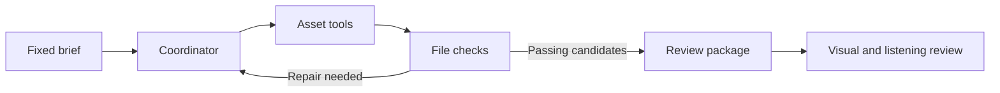

I start a game asset agent with a small delivery: one icon, one sound, and a folder containing enough information to review both. That scope exposes most of the engineering work: interpreting a brief, choosing tools, checking files, handling failure, and deciding when to stop.

For this walkthrough, I used Star Defense, a Unity/C# prototype. Its Overclock satellite already has a cyan clock motif. I used that visual identity for a new icon and added a short confirmation cue for selecting a reward.

The companion implementation runs locally. Its demo uses a scripted planner and procedural asset tools. An optional model adapter supplies the agent's decisions through tool calling. The recorded results below come from the local demo; live model behavior remains untested.

## 1. Write the asset brief first

The existing project gives me the clock shape and cyan color. Export dimensions, audio format, and acceptance thresholds are choices for this exercise.

```json
{
  "job_id": "star-defense-overclock-kit",
  "icon": {
    "id": "solar_overclock",
    "size": [256, 256],
    "color": "#61DED9",
    "background": "transparent"
  },
  "sound": {
    "id": "draft_confirm",
    "format": "PCM16 mono WAV",
    "sample_rate": 48000,
    "duration_seconds": 0.32,
    "maximum_peak_dbfs": -3
  }
}
```

I also write down the use: the icon appears in a small selection card, and the sound confirms an accepted choice. This affects visual detail and timing. A long musical sting would make repeated selections tiring.

The brief stays fixed throughout a run. Changing it creates a new version. Otherwise, a model could quietly relax the acceptance criteria to make a failed candidate appear acceptable.

## 2. Give one coordinator a small toolbox

Datawhale's Agent chapter provides a useful construction sequence: define tools, divide the task, keep working state, and repeat observation and action until a stopping condition is reached. I apply that sequence to the asset job. [Datawhale: AI Agents and Tool Calling](https://datawhalechina.github.io/easy-vibe/zh-cn/appendix/8-artificial-intelligence/ai-agents).

My first version has one coordinator and four functions:

| Tool | Responsibility |
|---|---|
| `render_icon` | Create a new icon candidate |
| `synthesize_sfx` | Create a new sound candidate |
| `inspect_asset` | Read file bytes and return checks |
| `package_review` | Collect passing candidates and their manifest |

The model chooses a function and supplies arguments. The host validates those arguments and executes the function. This gives me a clear place to enforce limits and record side effects.



The host permits packaging only after both current candidates pass. A fluent completion message cannot change that state.

## 3. Define tool contracts before connecting providers

Each function accepts a narrow schema. For example, the icon renderer receives this argument object:

```json
{
  "type": "object",
  "properties": {
    "background": {
      "type": "string",
      "enum": ["transparent", "opaque"]
    }
  },
  "required": ["background"],
  "additionalProperties": false
}
```

I retain the opaque option to exercise a deliberate failure in the demo. The brief still requires transparency. The sound tool accepts a numeric peak target between -24 and 0 dBFS, while inspection enforces the brief's ceiling.

Tool results contain a candidate ID, a relative file location, and a SHA-256 hash. Subsequent calls use the registered ID. The host constructs file paths, which keeps model-supplied strings out of filesystem operations.

The initial adapters draw a clock and synthesize a short tone using Node.js built-ins. They make the example reproducible without generation-service credentials. An image generator or sound-effects service can replace either adapter while preserving the result contract. Its wrapper must resolve asynchronous jobs and save the actual returned file before reporting success.

For an image-service adapter, my generation brief would read: “One cyan clock icon, two clear hands, centered silhouette, transparent background, legible at 32 pixels, with no lettering.” I would attach an approved style reference when the service supports image input. Export conversion then produces the required 256-pixel PNG and runs the same checks.

For an audio-service adapter, I would use: “A short electronic confirmation, light ascending character, immediate onset, clean ending, no voice or background music.” The wrapper converts the response to the specified PCM format and checks the duration. Speech synthesis and sound-effect generation need separate capability checks when selecting a backend.

Record the provider request ID, model revision, reference hash, and export settings alongside each generated file. These fields make a later change of provider or style reference visible in the complete delivery history.

## 4. Implement the decision loop

I keep orchestration visible in `asset-agent.mjs`. The essential loop is small:

```javascript
for (let turn = 1; turn <= 12; turn++) {
  if (job.state.package) return job.state;
  const response = await decide(input);
  input.push(...response.output);
  const calls = response.output.filter(x => x.type === "function_call");
  if (calls.length !== 1) handleMissingOrUnexpectedCalls();
  const call = calls[0];
  const result = await job.execute(call);
  input.push({
    type: "function_call_output",
    call_id: call.call_id,
    output: JSON.stringify(result)
  });
}
```

This is an abbreviated view; the companion file includes the branches and error handling. The model adapter submits the tool definitions, executes returned function calls through the host, and sends observations back. This follows the documented function-calling flow. [OpenAI: Function Calling](https://developers.openai.com/api/docs/guides/function-calling).

I retain the complete response output, including any reasoning items needed for continuation. Parallel tool calls are disabled for this first implementation. Sequential execution makes candidate selection, counters, and packaging easier to inspect.

If the model finishes before the package exists, the host reports the missing deliverable and allows another bounded turn. HTTP failures stop the run and preserve its state. Each request has a 40-second timeout.

## 5. Make the agent instruction operational

My instruction describes the work and its stopping condition:

```text
Prepare one Star Defense Overclock icon and one confirmation sound.
Use the fixed brief. Generate, inspect, repair failed candidates,
then package for human review.
Prefer a transparent background and a sound peak of -6 dBFS.
Report actual inspection metrics. Keep outputs in the job workspace.
Stop after package_review succeeds.
Human visual and listening review remains pending.
```

The host separately enforces two generation attempts per asset, twelve tool calls, and twelve model turns. These limits remain active if the model overlooks the instruction.

I improve prompts from observed failures. “Make a suitable icon” leaves dimensions and background open. Adding the brief resolves those choices. Adding a failed inspection explains the next repair: “All corner pixels are opaque; produce a transparent-background candidate.” That feedback names a condition the next tool call can change.

For context, I keep the brief and current tool observations available. Binary files stay on disk. A small state file records candidate IDs, attempts, checks, usage, and package status. This applies the practical idea of supplying relevant information at the point of decision. [Datawhale: Context Engineering](https://datawhalechina.github.io/easy-vibe/zh-cn/appendix/8-artificial-intelligence/context-engineering).

I keep style decisions stable too. The coordinator may repair transparency or gain within the brief. A request to change the clock into a different symbol should create a revised brief. This keeps technical retries separate from creative revisions and makes later comparisons interpretable.

## 6. Inspect the files independently

The image checker verifies PNG structure, checksums, dimensions, RGBA format, visible pixels, and transparent corners. It also requires more than half the canvas to be transparent for this specific sparse clock design. That threshold belongs to this brief; a background illustration would need different checks.

The audio checker reads WAV chunks and PCM samples. It checks mono output, 16-bit encoding, 48 kHz sampling, duration within one sample of 0.32 seconds, a non-silent signal, and peak level at or below -3 dBFS.

File properties establish technical compliance. I still inspect the icon at its intended display size and listen to the cue in context. Transparent corners alone cannot establish a clean silhouette. Sample peaks cannot establish a comfortable mix.

A multimodal reviewer can assist with visual feedback when it receives the actual image. An audio reviewer needs the actual sound. Filenames and generator descriptions provide insufficient evidence for either judgment. Keep subjective feedback attached to a specific candidate and hash so revisions remain traceable.

## 7. Test a repair path deliberately

The offline planner intentionally starts with two bad settings. This makes the failure path visible on every demo run.

| Candidate | Observation | Next action |
|---|---|---|
| Icon v1 | Opaque background; transparency check fails | Render a transparent version |
| Icon v2 | 256×256 RGBA; transparency check passes | Continue to sound |
| Sound v1 | Peak approximately 0 dBFS; ceiling exceeded | Render at -6 dBFS |
| Sound v2 | 0.32 seconds; measured peak -6 dBFS | Package for review |

The recorded run used nine tool calls: four generations, four inspections, and one package operation. Both assets needed two attempts. These counts describe the scripted fixture. They provide no estimate of a live model's repair success rate.

I preserve each candidate under a new versioned filename. A failed file remains useful evidence. The trace records the call ID, arguments, result, and inspection metrics, making the transition from failure to repair easy to follow.

## 8. Handle repeated calls and bounded failure

A repeated generation request can create duplicate work. Within a run, I cache results by call ID and arguments. Replaying the same call returns its previous result. Reusing the ID with changed arguments returns an error.

I check file hashes again before packaging. A candidate that changes after inspection loses its route into the review bundle. Unknown tools, extra arguments, unregistered IDs, and exhausted budgets also produce explicit errors.

The latest-candidate pointer matters here. If icon v1 passes and a later v2 fails, packaging must wait for v2 to be repaired or for an explicit selection change. Searching the folder for any passing file would hide the failed revision. The implementation gates each asset through its current registered candidate.

The companion guard checks exercise twelve cases, including an attempted arbitrary output path and a thirteenth tool call. All twelve passed in the recorded local check.

This cache covers one running process. A production worker needs durable request IDs and provider-job reconciliation before retrying an interrupted request. The current state file supports auditing; automatic restart recovery is a further implementation step.

## 9. Deliver a review package

The final folder contains the passing PNG, WAV, and `manifest.json`. The manifest records the brief hash, adapter version, parameters, file hashes, and inspection results. Visual review, listening review, and Unity import remain marked pending.

For Star Defense, I would first integrate the image in an isolated UI preview. The current HUD draws its satellite glyphs procedurally, so consuming a PNG needs an explicit presentation change. The sound should follow an accepted reward operation through an explicit feedback callback. A rejected duplicate click should produce no extra cue.

That handoff respects the project's existing boundary: Bootstrap coordinates gameplay transactions, while presentation reads results. Material generation should leave reward counts, combat timing, and inventory behavior intact.

## 10. Run the small version before expanding it

I ran both checks from the local `game-asset-agent` directory using Node.js 24 without installing packages:

```powershell
node example/asset-agent.mjs --demo
node example/guard-checks.mjs
```

The first command writes a new run directory containing candidates, state, a trace, and the review package. The second checks the execution boundaries.

The optional `--live` mode reads `OPENAI_API_KEY` and `ASSET_AGENT_MODEL`, then connects the coordinator to the Responses API. Asset generation still uses the local adapters. Test that mode separately and record model version, usage, failures, and human acceptance before making performance claims.

For that evaluation, I would include a correct job, a missing reference, an impossible output request, and a provider timeout. Track whether the coordinator asks a useful question, stops within budget, and reports the real blocker. File-validity scores and human acceptance should be reported separately; both matter to a working asset pipeline.

My next extension would be a second icon using the same brief structure. That tests whether naming, style references, and packaging survive a larger job. A looping ambience track would come later, with its own duration and loop-boundary checks.

The useful portfolio evidence is concrete: source code, a reproducible command, failed candidates, repair observations, and an honest review status. Those artifacts let another engineer inspect how the agent reaches its result.
