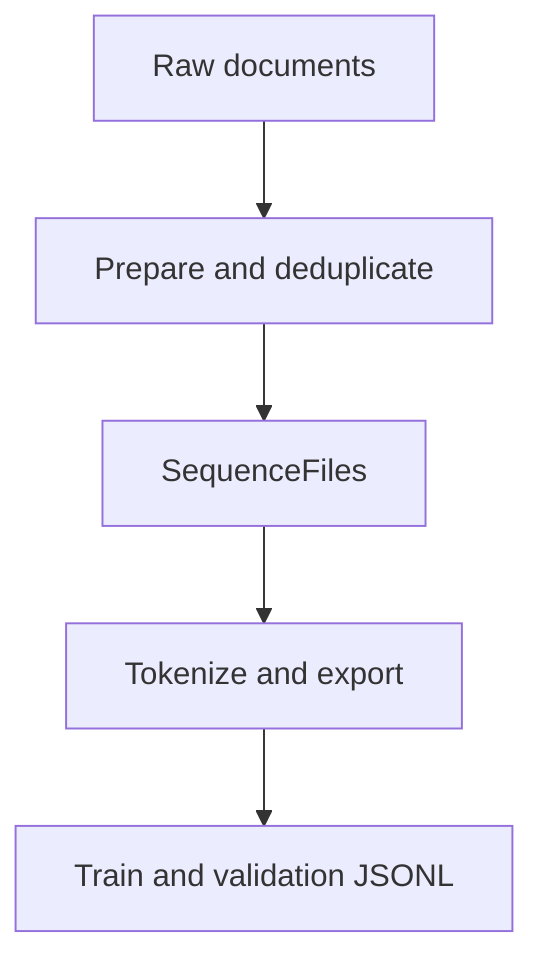
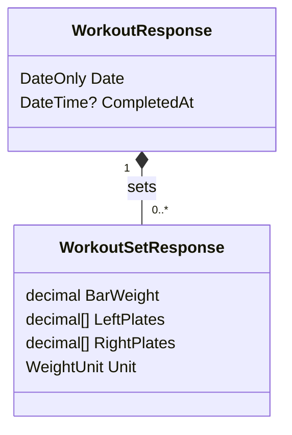

What does the second job in Distdemo read? I could answer that with a diagram of the whole cluster. For this question I only need the two jobs and the file that passes between them.

The middle box earns its place. The prepare job writes one record per distinct prepared document. The export job can then read those records and produce JSONL without shuffling them again. [The two job definitions](https://github.com/jayhuangsci/distributedSysUtilsDemo/blob/67741320b1d918157aeb032e77d9de616f8606e4/src/main/java/io/github/jayhuangsci/corpus/hadoop/CorpusPipeline.java#L63-L91)

In HabitTracker, I wanted to show where the plate stacks live. A workout has a date and a completion time. Its sets each carry their own bar, stacks, and unit, so a single workout can contain sets logged in pounds and kilograms.

The diagram leaves out fields such as notes and repetitions. I was looking for the home of the plate stacks, and the set box is enough to answer that. [The two response records](https://github.com/jayhuangsci/HabitTracker/blob/d3463cfb2ff3bc9d0940fb0ae5f936ae51c37d56/src/HabitTracker.Core/TrainingContracts.cs#L73-L94)

To put one of these in a Hugo article on this site, open a fenced code block with three backticks followed by `mermaid`. The page ships the text, and Mermaid turns it into a diagram in the browser. [Flowchart syntax](https://mermaid.js.org/syntax/flowchart.html) and [class diagram syntax](https://mermaid.js.org/syntax/classDiagram.html).
